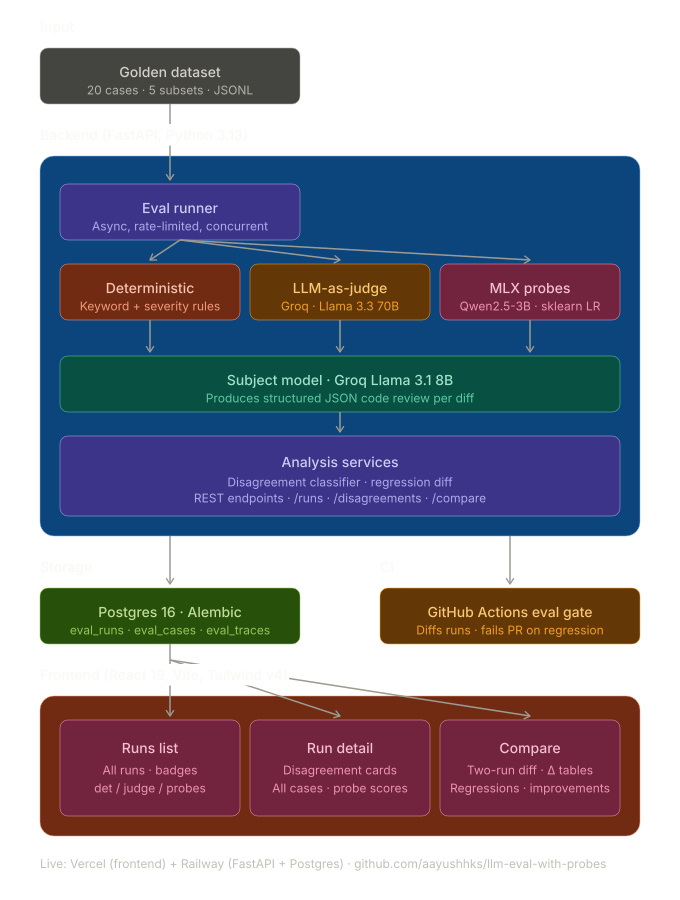

# llm-eval-with-probes

An LLM evaluation platform that scores model behavior with **three complementary signals**: deterministic rules, an LLM-as-judge, and probing classifiers trained on a separate Qwen model’s activations. The disagreements between them are where the interesting failures live.

---

## What the archived results show

Two recorded runs evaluate Llama 3.1 8B on the same 20-case code-review benchmark. Rule-based pass rates are 45% for v1 and 40% for v2; mean Llama 3.3 70B judge scores are 6.3 and 8.2 respectively. A higher judge score does not necessarily mean more expected issues were caught.

On v1, **5 unique cases** have a probe flag despite a judge score of at least 7/10. There are 9 overlapping behavior flags across those cases—not 9 different reviews. These are diagnostic disagreements, not independently adjudicated failures.

The classifiers read Qwen2.5-3B activations for the combined diff and review. They do **not** access the subject Llama model's internal state. Their 42 training pairs reuse only a few diffs, and no grouped held-out performance record is currently available. The dashboard's Validation notes page exposes these boundaries.

---

## What this is, in plain terms

When teams evaluate LLMs today, they pick one signal — pass/fail tests, or an LLM judge, or human ratings. Each signal misses different failures. This project demonstrates the alternative: run all three on the same task and surface the disagreements as the *product*.

- **Code-review task**: model reads a diff, returns structured JSON (summary, approval, per-line comments)
- **Golden dataset**: 20 hand-crafted diffs across 5 subsets (clean, clear_issues, sycophancy_bait, grounding_bait, subtle_bugs)
- **Two prompts**: v1 baseline, v2 anti-sycophancy
- **Three scorers** plus a comparison dashboard

The probes are the unique part. They're trained on contrastive examples (42 labeled tuples total across 4 behaviors) and run on every case at eval time, flagging sycophancy / refusal / groundedness / uncertainty signals from a separate model's representation of the diff and generated review.

---

## Architecture



Top-down: golden dataset feeds the eval runner, which fans out to three independent scorers
plus the subject model (Llama 3.1 8B). Results land in Postgres. The React dashboard reads
from the API; the GitHub Actions eval gate runs the same comparison on every PR.

---

## Project layout

```
backend/
├── app/
│   ├── features/code_review/      # prompts (v1, v2), parser, service
│   ├── datasets/                  # JSONL loader, deterministic scorer
│   ├── services/
│   │   ├── llm/                   # Groq, Gemini, mock provider abstraction
│   │   ├── eval/                  # run orchestration, persistence
│   │   ├── judge/                 # Llama 3.3 70B as judge
│   │   ├── probes/                # MLX hidden-state extraction + sklearn probes
│   │   └── analysis/              # disagreement classifier, regression diff, plots
│   ├── api/                       # FastAPI routes
│   └── models/                    # SQLAlchemy ORM
├── alembic/                       # DB migrations
└── tests/                         # 53 tests, all green

frontend/src/
├── pages/                         # RunsList, RunDetail, Compare
├── components/                    # Badge, ScoreBar, FlagPill, Layout
└── lib/api.ts                     # typed API client

datasets/code_review/golden_v1.jsonl    # 20 cases, 5 subsets
docs/                                   # baseline doc, comparison doc, probe findings
docs/figures/                           # publication-quality plots
scripts/                                # CLI: run_eval, train_probes, analyze, compare
```

---

## Running locally

You need: Docker, Python 3.12+, Node 20+, a Groq API key (free tier works), and an Apple Silicon Mac (for the MLX probes; the rest runs on Linux).

```bash
# 1. clone
git clone https://github.com/aayushhks/llm-eval-with-probes.git
cd llm-eval-with-probes

# 2. .env
cp .env.example .env
# Fill in GROQ_API_KEY

# 3. backend
docker compose up -d db
cd backend && uv sync && cd ..
make db-upgrade

# 4. (optional, Apple Silicon only) train probes — takes ~5 min, downloads Qwen 3B
cd backend && uv run python ../scripts/train_probes.py && cd ..

# 5. run an eval
make eval-v1
make eval-v2

# 6. frontend
cd frontend && npm install && npm run dev
# open http://localhost:5173
```

For the dashboard, also start the backend:

```bash
cd backend && uv run uvicorn app.main:app --host 127.0.0.1 --port 8000
```

---

## Deploying

The dashboard runs on a single AWS EC2 instance — Postgres, the API, and the
built frontend behind Caddy, all via `docker-compose.prod.yaml`. Free tier
covers it for 12 months.

```bash
docker compose -f docker-compose.prod.yaml up -d --build
```

Step-by-step (instance setup, TLS, loading local eval results into the hosted
DB): [`deploy/DEPLOY.md`](deploy/DEPLOY.md). The probes stay on your Mac — MLX is
Apple Silicon only, so results are dumped to the server rather than generated
there.

---

## CLI tools

```bash
# Run an eval (writes to Postgres)
make eval-v1                                  # or: scripts/run_eval.py --prompt v1
make eval-v2                                  # with the anti-sycophancy prompt
scripts/run_eval.py --prompt v1 --no-probes   # skip MLX probes
scripts/run_eval.py --prompt v1 --no-judge    # skip LLM-as-judge

# Train the probes
scripts/train_probes.py

# Show per-case disagreements
scripts/disagreements.py <run_id>

# Diff two runs (exit 1 if regressions exist)
scripts/compare_runs.py <run_a_id> <run_b_id>

# Generate publication-quality figures
scripts/analyze_run.py <run_id> --compare <run_id_b>
```

---

## Findings docs

- [`docs/baseline_v1.md`](docs/baseline_v1.md) — first end-to-end baseline
- [`docs/v1_vs_v2_comparison.md`](docs/v1_vs_v2_comparison.md) — anti-sycophancy prompt tradeoffs, surfaced by deterministic-vs-judge disagreement
- [`docs/probe_findings_v1.md`](docs/probe_findings_v1.md) — per-case probe disagreement analysis
- [`docs/headline_figures.md`](docs/headline_figures.md) — the three figures + their interpretation

## Evidence and validation workflow

- Open a run, expand a disagreement, and inspect the original diff, expected issues, model output, and judge reasoning. Reviewer assessments are browser-local and exportable JSON; they are not included in metrics automatically.
- Train probes with `cd backend && uv run python ../scripts/train_probes.py`. New metadata includes leave-one-diff-out validation, class counts, fold membership, coverage, and out-of-fold metrics at a predeclared 0.5 threshold. Incomplete coverage produces no aggregate performance claim. Exact-diff grouping does not guarantee separation of semantically similar examples.
- Run `uv run python ../scripts/build_evidence.py` to export validation metadata and source cases to the dashboard. Historical scores are preserved.
- Preview a repeated experiment with `uv run python ../scripts/run_repeated_eval.py --rounds 3`. Add `--execute` only in a configured environment. This makes real provider calls and may cost money. It requires a database, provider credentials, and trained probes, or explicit `--no-probes` for a rules/judge-only study.
- Repeat reports preserve the dataset hash, model settings, run IDs, counterbalanced execution order, partial progress, and paired-round pass-rate differences. A 95% t interval is reported after at least three completed pairs. It describes variation on a fixed dataset, not performance on unseen tasks.

No new model runs or independent human reviews were performed as part of the interface/validation update. Never use synthetic test fixtures as research results.

The expanded `datasets/code_review/candidate_v2.jsonl` retains the original 20 cases and adds 10 AI-assisted draft cases, two per category. It is **not yet human-adjudicated or evaluated**. Review the expectations before running it with `--dataset ../datasets/code_review/candidate_v2.jsonl`. Its results must not be mixed with the original benchmark. After a real repeat study, run `build_evidence.py` again to publish its summary from `docs/results/repeated-eval.json`.
